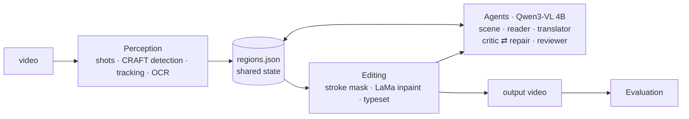

# animefix: an agentic pipeline for translating text burned into anime

animefix (CLI: `animtl`) finds Japanese text that is drawn into the frames of an anime clip (title cards, phone
screens, signs), erases it, and draws English in its place, matching the colour and outline.
The rest of the frame and the audio are left untouched.

Deterministic computer-vision models do the pixel work. A **local vision-language model agent**
(Qwen3-VL 4B via Ollama) makes the judgement calls: it corrects OCR misreads by looking at the
text, translates each screen as a whole while checking that every line fits, inspects its own
output, and repairs what fails. Everything runs offline on a laptop GPU (RTX 3070 Ti, 8 GB).

## Results on a 15-second clip

A 1546×856, 30 fps, 438-frame clip: an episode title card, then a phone menu with a scrolling
list. Same perception and rendering in both columns; only the decision layer differs.

| Japanese on screen | Baseline (OCR → Google Translate) | Agent (local 4B VLM) |
|---|---|---|
| カピバラ, misread by OCR as カピパラ | "Capipara" | **"Capybara"**: the reader agent fixed the reading using dictionary evidence |
| はなすはやさ (a settings label) | "Talking Quickly" | **"Speech Speed"** |
| キャラのこえ | "Character's Voice" | **"Character Voice"** |
| アップデートするゾ (title, boastful ゾ) | "To Update" | **"Update It!"** |
| いろをきめる (cut off by the frame edge in every frame) | missed silently | missed by perception, **flagged for a human** by the reviewer agent |

| Metric | Value |
|---|---|
| Japanese detected in output (OCR on 49 sampled frames) | 115 → **0** |
| Damage outside edited regions | **40.6 dB** PSNR (re-encoding loss only) |
| Share of the frame edited | 6.7% |
| Flicker inside edited boxes while the source is static | 0.03, versus 0.16 in the source itself |
| Agent cost | 42 model calls, 23 tool calls, 54k tokens, about 80 s of model time on an RTX 3070 Ti laptop |
| Repair loop under fault injection (`scripts/fault_injection.py`) | 2/2 sabotaged tracks caught in round 1 and fixed in one repair round; control untouched |

Full decision log of that run: `agent_report.md` (generated) and `agent_trace.jsonl` (every
model call and tool call).

## How it works



| Phase | Who | What happens |
|---|---|---|
| 1. Perceive | CV pipeline | Split into shots; detect text (CRAFT) on frames that changed; track it (IoU + text similarity); read it (CRNN, confidence-weighted vote); drop logos and noise by confidence; recover text cut off by the frame edge |
| 2. Understand | Scene agent | The VLM looks at each screen and describes it ("a phone settings menu", "a comedic title card"): context for the next steps |
| 3. Read | Reader agent | The VLM checks every OCR reading against the image and dictionary evidence, and fixes look-alike kana (バ/パ). A guardrail accepts corrections only, never new text |
| 4. Translate | Translator agent (tool loop) | Translates a whole screen at once, grounded by dictionary glosses; calls `lookup` for unknown words and `check_fit` (the real layout engine) to see whether each line fits, then `submit` |
| 5. Critique ⇄ repair | Critic + repair agent (tool loop) | Renders stills; OCR re-check for leftover Japanese; measured contrast ratio; the VLM reads the English back; failures go to a repair agent with typed tools (`grow_mask`, `set_outline`, `set_english`, `accept`), then everything is re-rendered and re-checked |
| 6. Render | Editing pipeline | Stroke-level masks, LaMa inpainting with clean-plate reuse, typesetting in the sampled style, logos kept on top, original audio copied |
| 7. Review | Reviewer agent | Looks at finished frames for Japanese that perception missed, and flags it for a human |
| 8. Evaluate | Metrics | Text removed, damage outside edits (PSNR), edited area, flicker |

The agents never change pixels. They edit `regions.json` (readings, English, style
parameters), and the deterministic renderer applies those edits only inside text masks.
[docs/DESIGN.md](docs/DESIGN.md) explains the models, the agent patterns, the guardrails and the
evaluation in detail.

## What's interesting here

- **Agents for judgement, CV for pixels.** Each layer does what it's reliable at, and a bad model
  decision can't damage a frame.
- **Grounded tool use.** The translator checks its line lengths against the same layout engine
  that will draw them, and looks words up in a dictionary (JMdict) instead of trusting a 4B
  model's vocabulary.
- **Self-verification with more than one signal.** A deterministic OCR re-check, a measured WCAG
  contrast ratio, a read-back test, and the VLM's own judgement. Fault injection showed why the
  measurements matter: the VLM happily "read" English that was nearly invisible.
- **Guardrails on every decision.** Similarity and length constraints on corrections, clamped tool
  parameters, step and round budgets, token caps and retries for runaway generations, and a
  fallback per agent.
- **Observable and resumable.** Every model call and tool call is in `agent_trace.jsonl` with tokens
  and latency. Progress is checkpointed after every phase (`--resume`).
- **Local-first.** A 4-bit 4B VLM shares an 8 GB GPU with EasyOCR and LaMa. Frame-change
  detection and patch reuse skip the work on frames that repeat (anime is animated "on twos").

## Run it

```powershell
# one-time
uv sync                         # Python 3.11, CUDA PyTorch, EasyOCR, OpenCV
ollama pull qwen3-vl:4b-instruct   # the agent's model (3.3 GB)

# agentic pipeline -> Demo_en.mp4, Demo_work/agent_report.md, Demo_work/agent_trace.jsonl
uv run animtl agent ..\Demo.mp4

# measure any output against its source
uv run animtl eval ..\Demo.mp4 ..\Demo_en.mp4

# non-agentic baseline: same perception and rendering, Google Translate in between
uv run animtl run ..\Demo.mp4
```

`ffmpeg` must be on PATH. The first run downloads EasyOCR (about 100 MB) and LaMa (about 200 MB)
weights.

| Command | Options |
|---|---|
| `agent` | `--model` (any Ollama vision model with tool calling), `--rounds` (critique/repair budget, default 2), `--reanalyze`, `--resume` |
| `run` / `analyze` / `translate` / `render` | the step-by-step baseline: `--translator google/none`, `--det-stride`, `--ignore X,Y,W,H`, `--font`, `--encoder nvenc`, `--crf` |
| `eval` | `VIDEO OUTPUT [--work DIR]` |

`regions.json` can be edited by hand between steps. `render` draws exactly what is in it.

## Project layout

```
animtl/
  perception/   detect.py (EasyOCR/CRAFT) · track.py · overlay.py (logo protection) · analyze.py
  agent/        llm.py (Ollama client) · agents.py · orchestrator.py · dictionary.py · workspace.py · trace.py · report.py
  editing/      typeset.py (masks, style, layout) · inpaint.py (LaMa) · render.py
  eval/         metrics.py
  translate.py  Google MT baseline
  video.py      decoding, shot detection, change detection, ffmpeg encoding
scripts/fault_injection.py   breaks a finished run on purpose and checks the critique/repair loop
docs/DESIGN.md               models, agent patterns, guardrails, evaluation, what testing changed
```

## Limits

- Text that is partly cut off in *every* frame where it appears is never detected. The reviewer
  agent flags it for a human; turning those flags into tracks automatically (VLM grounding) is
  the next step.
- LaMa inpaints single images. Moving text over a moving background can shimmer; a video
  inpainting model (ProPainter) would fix that.
- A 4B model's translations are good on labels and weaker on jokes and wordplay, and vary a little
  between runs ("Speech Speed" / "Talk Speed"). Any Ollama model can be swapped in with `--model`.
- Dictionary lookups use the jisho.org API (cached per project). Offline, the agents run without
  dictionary hints.
