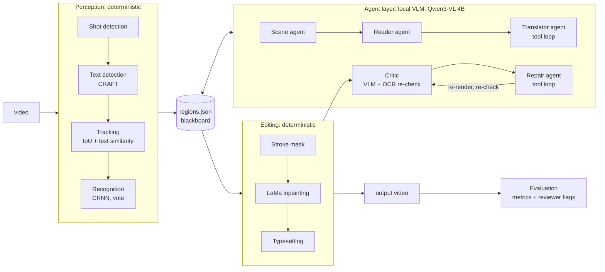

# Design notes

This document explains how animtl is built and why: the models it uses, how the agent layer
is put together, the guardrails around it, and how results are measured.

## 1. The problem

Burned-in text is part of the image. Nothing in the video file says where it is. Replacing it
takes five separate tasks:

| Task | Difficulty in anime |
|---|---|
| **Detect** where text is | Stylised lettering, text over busy art, logos that look like text |
| **Recognise** what it says | Look-alike kana (バ/パ, ソ/ン), small dakuten marks, text cut off by the frame edge |
| **Translate** it | 3-character UI labels with no sentence around them; character voice (Shin-chan's ゾ) |
| **Erase** it | Rebuild what was behind the strokes without touching anything else, consistently across frames |
| **Typeset** English | Match colour and outline; fit the space; stay steady while the source is static |

Every one of these is done per frame, but the result has to look right as video. A
per-frame method that flickers is a failure even if each still looks fine.

## 2. Architecture

There are three layers, and the boundaries between them are deliberate:

- **Perception** and **editing** are deterministic. They are tested, reproducible, and the
  only code that reads or writes pixels.
- The **agent layer** makes judgement calls. It reads and writes one structured file
  (`regions.json`), which acts as a shared blackboard. It can't change a pixel directly;
  it can only change a track's reading, its English, or its style parameters.

That split is the central design choice. The model's mistakes stay contained: the worst a
bad decision can do is put the wrong word in a box. It can't damage the frame.

## 3. Models and algorithms

| Component | What it is | Why it's here |
|---|---|---|
| **PySceneDetect** `ContentDetector` | Frame-difference threshold in HSV space | Cuts are where tracks must reset; text-free shots can be skipped |
| **CRAFT** (via EasyOCR) | CNN predicting, per pixel, a *region* score (character centre) and an *affinity* score (gap between characters of one word) | Works at character level, so it handles stylised and spaced-out kana better than word-box detectors |
| **EasyOCR recogniser** | CRNN: CNN features, then a BiLSTM, decoded with CTC | Fast; gives a confidence per reading, which the pipeline relies on to separate text from logos |
| **manga-ocr** (optional) | Vision encoder-decoder (ViT encoder, Japanese BERT-style decoder) trained on manga | Better on stylised lettering when CRNN is unsure |
| **LaMa** | Inpainting network built on *Fast Fourier Convolutions*: part of every layer works in the frequency domain, so even early layers see the whole image | Ordinary CNNs see only a local neighbourhood, and large holes come out blurry. FFCs reproduce repeating structure (the menu's stripes) across the hole |
| **Qwen3-VL 4B Instruct** (Ollama, Q4_K_M, about 3.3 GB) | Vision-language model: an image encoder feeding a 4B-parameter language model, quantised to 4 bits | Small enough to share an 8 GB GPU with EasyOCR and LaMa, and it can look at images, call tools and read Japanese |
| **JMdict** (via jisho.org, cached) | Japanese-English dictionary | Grounds the small model's vocabulary; fuzzy search exposes OCR misreads |
| Median filter background estimate | Per-pixel median over a window about the size of the text height | Thin strokes disappear and flat colours and gradients stay, so the difference is the text |
| k-means colour clustering (k=4) | Over high-contrast pixels in the box | The cluster with the most contrast mass is the text fill. Restricting the mask to it keeps an overlapping logo out of the mask |

## 4. The agent layer

### Workflow or agent?

A fully autonomous agent picks its own next step from a set of tools at every turn. That
works with frontier models, but a 4B model running locally makes too many mistakes when
planning many steps ahead. So the system uses an **orchestrator-workers** structure:

- the orchestrator runs the phases in a fixed order (perceive, understand, read, translate,
  render, critique, repair, review, evaluate);
- inside each phase, an LLM worker with one narrow job makes the decision.

Autonomy goes where the model is good: looking at an image, choosing words, judging a result.
It's held back where it's weak: long-range planning.

### The workers

| Agent | Sees | Output | Mechanism |
|---|---|---|---|
| Scene | The frame | `{kind, description, tone}` | JSON-schema constrained output |
| Reader | A crop of the text, OCR candidates, dictionary evidence | Reason, is-it-text, corrected reading | JSON-schema constrained output |
| Translator | All lines on one screen, their pixel sizes, dictionary glosses | English per line | **Tool loop**: `lookup`, `check_fit`, then `submit` |
| Critic | Before/after crop | Japanese left? English read back? Contrast? Natural? | JSON schema, combined with an OCR re-check and a measured contrast ratio |
| Repair | Failed crops and the reasons | One fix per failure | **Tool loop**: `grow_mask`, `set_outline`, `set_english`, `accept` |
| Reviewer | Finished frames, plus full-resolution crops around the text that was found | Japanese the pipeline missed | JSON schema; results go to a human, not to auto-fix |

### Patterns used

- **Tool use / function calling, run as a ReAct loop.** The model chooses a tool and its
  arguments. The result goes back into the conversation, and the model continues until it
  calls the terminal tool or the step budget runs out. A tool that fails returns its error
  message, so the model can correct the call.
- **Grounding in real measurements.** The translator doesn't guess whether "Character's Voice"
  fits. `check_fit` runs the actual layout engine and reports the font size it would get. The
  model is reasoning about numbers the renderer will actually produce.
- **Retrieval grounding (RAG plus a tool).** A 4B model's vocabulary has gaps. Before the model
  is asked anything, each line is split into words with a Japanese-English dictionary
  (JMdict, through the jisho.org API, cached), and the glosses go into the prompt. The translator
  can also call `lookup` itself, and in testing it did so without being told to. jisho's search
  is fuzzy, so looking up a misread word (カピパラ) returns the real one (カピバラ, capybara). That's
  the evidence the reader needs to correct OCR.
- **Few-shot examples** of hiragana settings labels (もじのはやさ → "Text Speed"). The model
  ignored the abstract rule "labels are noun phrases" and followed the examples.
- **Evaluator-optimizer.** Render, critique, repair, and re-render, up to N rounds.
- **Structured outputs.** Ollama turns a JSON schema into a grammar that constrains decoding.
  A 4B model can't produce malformed JSON or an out-of-range enum.
- **Hybrid verification.** The critic doesn't trust the VLM alone:
  - EasyOCR is run again on the edited frame. If it still finds Japanese with confidence 0.3 or
    more, that's a hard failure, independent of the model.
  - **Read-back test**: the VLM is asked to read the English in the result. If it can't (string
    similarity below 0.6), the text is missing or garbled.
  - **Measured legibility**: the WCAG contrast ratio between the text colour and the
    background (or between text and outline, when there is one) must be at least 3:1.
  - The VLM's own judgement ("Japanese visible", "contrast weak", "looks natural") is the last
    signal. The repair agent may dismiss it as a false alarm with `accept`, which is recorded in
    the trace.
- **Human in the loop.** The reviewer's flags (Japanese that perception never detected) are
  reported, not acted on. `regions.json` stays hand-editable, and `render` draws exactly what
  is in it.

### Guardrails

| Risk | Guardrail |
|---|---|
| Reader invents or truncates text instead of correcting it | Accepted only if the result is still Japanese, at least 50% similar to the OCR reading, and within one character of its length |
| Model gets stuck repeating itself | Output token cap, `maxLength` on text fields, retry, then a safe per-agent fallback |
| Reader deletes real text as "not text" | Only tracks whose OCR confidence is below 0.5 can be dropped |
| Translation that doesn't fit | `submit` rejects lines that fail `check_fit` once, with the reason |
| Repair over-correcting | Typed tools with clamped parameters (mask growth 2–12 px), and a round budget |
| Endless loops | Step budget per tool loop, round budget for critique/repair |
| Damage to the frame | Agents never touch pixels; the renderer only changes pixels inside stroke masks, and logos are protected |
| Missing translation | Falls back to Google MT instead of leaving Japanese on screen |

### What testing changed

These came from running the agents on real frames and reading the traces:

| Finding | Fix |
|---|---|
| The default `qwen3-vl:4b` tag is the *thinking* variant: 7,600 hidden reasoning tokens and 124 s for one translator step, even with `think: false` | Switched to `qwen3-vl:4b-instruct`. The same 7 calls take 16 s instead of about 6 minutes |
| The reader's reason said "the correct word is カピバラ" while its answer still said カピパラ | Constrained decoding writes fields in schema order, so the model committed to an answer before reasoning. Putting `reason` before `reading` in the schema fixed it |
| A scene description that mentioned the panda on screen made the translator call the capybara "Panda" | The scene prompt now asks for one sentence about the *kind* of screen, with no guessing at the text |
| Once, the reader got stuck repeating a phrase: 6,900 tokens, 85 s, unterminated JSON | Output cap (`num_predict`), `maxLength` on text fields, retry with a brevity instruction and higher temperature, then a safe fallback per agent (for example, keep the OCR reading) |
| **Fault injection** (English drawn in the background colour, nearly invisible): the VLM still read it back perfectly, so the read-back test can't detect low contrast | Added the measured contrast ratio. With it, both faults are caught in round 1 and fixed by the repair agent (black outline) in one round; the control track is untouched (`scripts/fault_injection.py`) |
| The repair agent first chose a *white* outline on a light background (RGB numbers alone weren't enough) | The failure reason now says "on a light background" in words; the fix is right first time |
| Asked about whole frames, the reviewer missed a half-visible row of text; in a tight crop it read it | The reviewer also looks at full-resolution crops around the text that was found, where missed list rows are most likely |

The pattern behind most of these: **use the model for judgement, but measure anything that can
be measured** (fit, contrast, leftover text), and treat the model's output as one signal among
several.

### Observability

Every model call and tool call goes to `agent_trace.jsonl`, with its inputs, outputs, image
count, token counts and latency. `agent_report.md` summarises the decisions, the
corrections with the model's reasons, QA rounds and repairs, flags and metrics.

### Running locally

- The model runs on the same GPU as the vision models. Peak use is roughly 4 GB for the VLM,
  1 GB for EasyOCR and 1.2 GB for LaMa, so it fits an 8 GB laptop GPU.
- Before the full render, the orchestrator unloads the model (`keep_alive: 0`) to give LaMa
  headroom.
- Images are downscaled to at most 768 px on the long side before they're sent to the model,
  which bounds the number of image tokens per call.

## 5. Efficiency

| Technique | Effect on the demo clip |
|---|---|
| Probe shots sparsely and skip text-free shots | Detection only runs where there's text |
| Change detection at 1/4 resolution, which averages away codec noise and keeps real changes | Detector ran on 246 of 438 frames |
| Clean-plate reuse while text and its surroundings are static | One inpaint serves many frames, and there's no flicker |
| Copy the previous edit onto unchanged frames | 149 frames with text needed no computation |
| Lazy model loading (manga-ocr only when needed, VLM unloaded before render) | Lower peak memory |

## 6. Evaluation

There's no reference translation for most anime, so `animtl eval` measures what can be
measured objectively:

| Metric | Question it answers |
|---|---|
| Japanese detections, input vs output | Did the text actually go away? |
| PSNR outside editable regions | Was anything else damaged? Only re-encoding loss should show |
| Share of frame edited | How surgical is the edit? |
| Change inside edited boxes while the source is static | Does the edit flicker? |

The agent run adds the QA pass rate per round, the reading corrections, and the reviewer's flags.

## 7. Limits and next steps

- **Recall on partly visible text.** Text cut off in every frame is never detected. Qwen-VL
  models can return bounding boxes, so the reviewer's flags could become new tracks
  automatically (VLM grounding), with OCR used to confirm them.
- **Video inpainting.** LaMa works on single images. A flow-guided video inpainter (ProPainter,
  E2FGVI) would keep moving text over moving backgrounds consistent over time.
- **Translation quality.** Measure it against a small reference set with chrF or COMET, and
  compare models of different sizes.
- **Critic calibration.** Label a set of before/after crops by hand and measure the VLM
  critic's precision and recall. Its false alarms are currently absorbed by the repair agent's
  `accept`.
